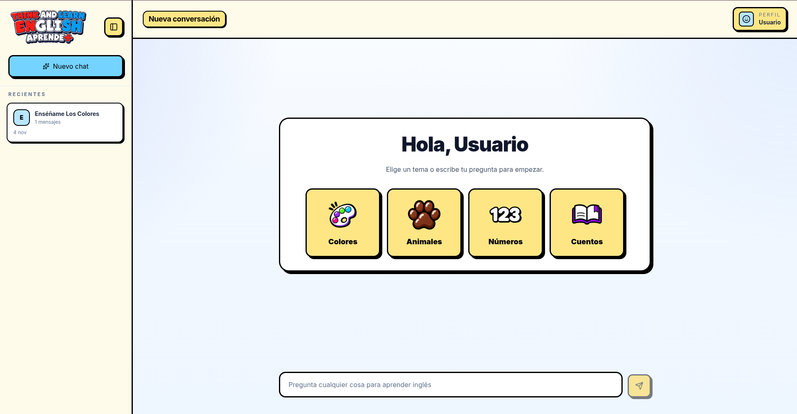

# Aprende+

An English tutor that runs on your own computer. Load a GGUF model and practice grammar, vocabulary, stories, and conversation at A1-A2 level.

Runs on llama-cpp-python, with a FastAPI backend and a Svelte chat UI.

> **Note:** This is an educational prototype.

## Features

- Runs fully offline
- Streaming responses
- Chat history saved in SQLite
- Multiple sessions: create, switch, delete
- Topic shortcuts: colors, animals, numbers, stories
- Voice reader using Piper TTS
- Portable build via PyInstaller, runs from a folder

## Stack

| Layer | Tech |
|---|---|
| Backend | Python 3, FastAPI, uvicorn |
| LLM | llama-cpp-python |
| Storage | SQLite |
| Frontend | Svelte 5, Vite |
| Styling | Tailwind CSS, Lucide |
| TTS | Piper (local neural voices) |

## Quick start

1. Download the latest `AprendeMas-vX.X.X-win-x64.zip` from [Releases](https://github.com/jezmn/aprendemas/releases).
2. Place a `.gguf` in `model/` (see [docs/MODEL.md](docs/MODEL.md)).
3. Place Piper voices in `voices/` (see [docs/INSTALLATION.md](docs/INSTALLATION.md)).
4. Run `AprendeMas.exe`.

Full instructions: [docs/INSTALLATION.md](docs/INSTALLATION.md)

## Documentation

- [Installation](docs/INSTALLATION.md)
- [Model selection](docs/MODEL.md)
- [Building (cross-CPU + release)](docs/BUILDING.md)
- [Database schema](docs/DATABASE.md)
- [Project structure](docs/STRUCTURE.md)

## License

MIT
